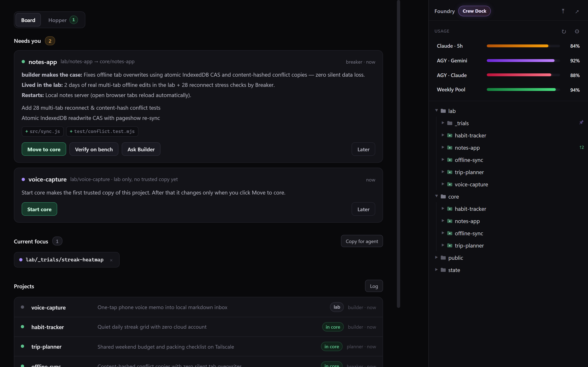
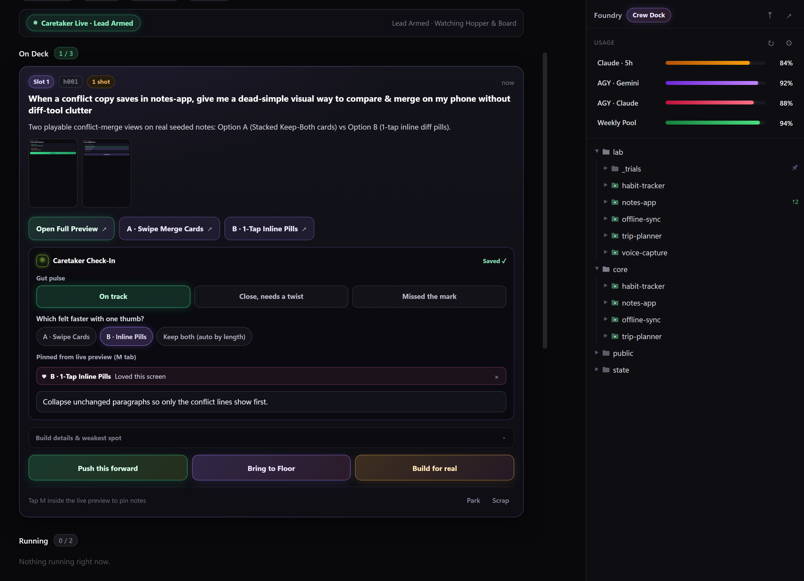
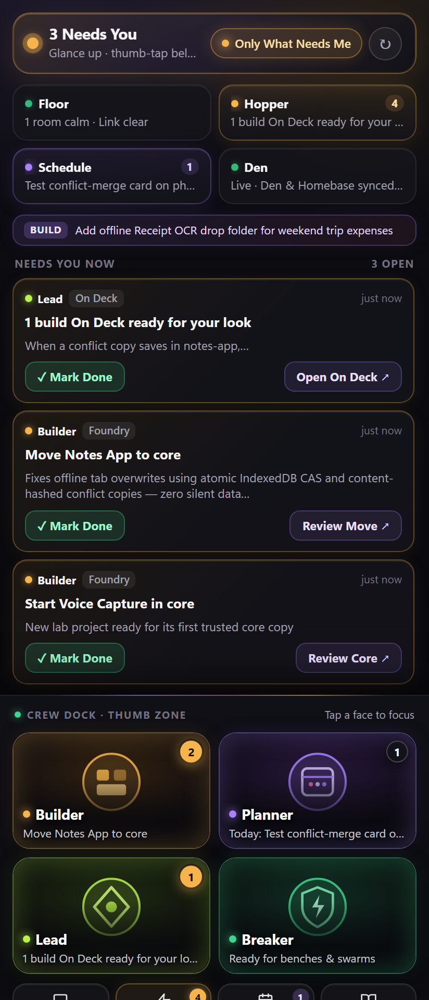
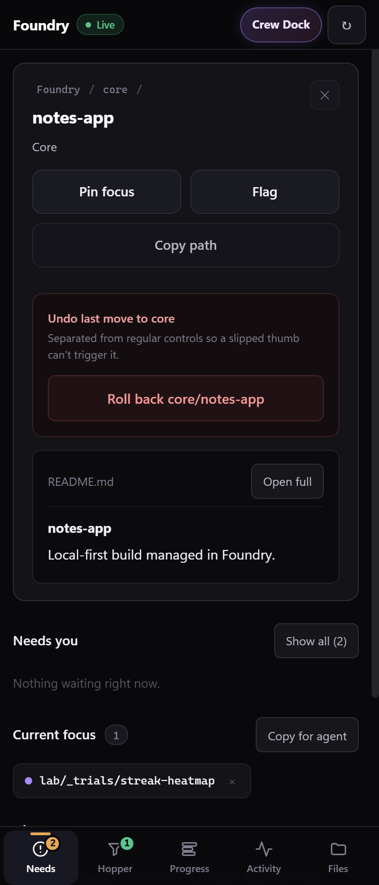

# The Foundry

**One dark local workshop on PC and phone where your AI can build at full speed — without ever breaking what already worked yesterday.**

A fast, pure-dark local home for all the projects you build with **Claude and Antigravity**. Plain folders and plain git underneath—zero GitHub PR clutter, zero cloud accounts, `$0` forever, and one-thumb control from your phone over private Tailscale.

**Why I built this (the real pain point):**
When I started moving fast with multiple AIs, **everyone pushed straight to Core instantly.** An AI would pass one quick test or save a file, pat itself on the back, and ship it straight into the daily apps I was actively relying on. Worse, every save automatically threw a promotion button onto my board, and clicking it swept up whatever else happened to be sitting in that folder—so one tiny bug fix would quietly drag two half-baked experiments right over top of what worked ten minutes ago.

In **three days**, we hit **66 moves to core**. My daily tools turned back into a live testing ground, nobody could tell which AI changed what, and I literally had to stop all work because *everything was overwriting everything*.

**Every single piece of The Foundry exists because of that three-day mess.** Everything here has a reason, starting with one rule: **nothing moves up just because someone saved.** Your AIs get isolated benches where they can swing big and break things freely, while the apps you actually live in stay rock-solid until an AI makes a plain-English case and *you* tap **`Move to core`**.

---

## Start in two minutes — your AI handles everything

You never wire up git worktrees by hand, edit config JSON, or memorize CLI flags. The Foundry ships with its own skill file so **Claude** and **Antigravity** already know how the whole workshop runs.

- **Already using [The shelves](https://github.com/HunterBryson/the-shelves)?** Just tell your AI: **"Set up The Foundry for us."**
- **Starting standalone in Claude (Code tab) or Antigravity?** Paste this one sentence and press Enter:

> Set up The Foundry for me from https://github.com/HunterBryson/the-foundry. Read its CLAUDE.md there first, configure `foundry.config.json` and my local `lab/` and `core/` folders, run `node scripts/check-setup.mjs`, and open the Foundry board for me.

**That's it.** Your AI sets up the folder spine on your computer, installs the Foundry skill so it already knows how benches and promotions work, checks the local server, and opens The Foundry cleanly in your browser—with a quick walkthrough if you want it on your phone over private Tailscale too. *(Windows & macOS, Node 20+, zero npm install required.)*

---

## Why four stages (`Bench → Lab → Core → Public`) — everything has a reason

I didn't wake up wanting a four-stage pipeline. Every stage showed up only after its missing piece bit me in real life:

- **1. The Bench (`foundry trial`) — so trying a wild idea never touches active work:**
  Before benches, asking two AIs to try two things in the same folder meant instant collisions. Now every new piece of work starts on its own isolated bench (`lab/_trials/<name>`) with its own copy and scratch port. An AI can refactor half the codebase, hate how it feels, and throw the bench away (`trial kill`) with zero trace left behind.
- **2. The Lab (`lab/`) — because passing a unit test doesn't mean the screen actually works:**
  AIs love seeing green checkmarks in a terminal and declaring victory—even when a mobile button won't scroll on a real phone. A bench only lands in `lab/` on your word (keeping the prior lab snapshot one command back), giving you a real live preview to poke on your PC or phone *before* anyone touches Core.
- **3. Core (`core/`) — locked behind a plain-English case, version-pinned, and auto-verified:**
  Core stays completely quiet while you experiment. A **`Move to core`** card only appears on your board when an AI writes a three-line plain-English case: **why** this matters, **how long it actually lived** in real testing, and **what restarts**. Better yet, that card locks to that *exact* tested version—so if another AI saves something new in `lab/` five minutes later, it can't hitch a free ride into Core. When you tap **`Move to core`**, **Live Match** verifies the running app actually came up healthy on the new version, or rolls back automatically.
- **4. Public (`public/`) — share clean builds without leaking your life:**
  Your local apps naturally hold your own paths, ports, and personal setup. When you want to share a project on GitHub, `public/` carries out only the clean, scrubbed build so strangers get something ready to run without you babysitting branches.

### Wait — who are `Builder`, `Breaker`, `Lead`, and `Planner` in the screenshots?

**Those names—and having five projects in the sidebar—are just examples shaped over time**, not locked presets.

You don't need four agents on day one. Start with **one** AI (Claude *or* Antigravity) and **one** project folder—just having `Lab` vs `Core` with one-tap rollback saves you the very first time an eager refactor breaks yesterday's working app. As you grow, each AI simply signs its own saves (`--by <name>`) so your board always tells you who built what, who tested it, and why.

---

## The Hopper & On Deck Check-In — drop raw sparks without derailing active builds

Here was the next headache: my best ideas always hit away from my desk with thirty seconds on my phone. If I dropped a raw, half-baked idea straight into an active coding chat, my AI would immediately drop what it was doing and start tearing up the live repo.

**The Hopper gives raw sparks their own studio lane.**

- **Drop a messy one-liner from anywhere:** Type a rough itch (*"give me a dead-simple visual way to compare & merge on my phone without diff-tool clutter"*), tap **`Explore angles`** or **`Prototype`**, and pocket your phone.
- **Compare real playable options (`On Deck`), not walls of text:** Instead of asking twenty spec questions, a Caretaker seat can spin up two or three real contenders side by side on dedicated preview ports (`Option A · Swipe Merge Cards` vs `Option B · 1-Tap Inline Pills`) seeded with realistic dummy data—never touching `lab/` or `core/`.
- **Ten-second Check-In (zero homework):** Open the live preview, tap the floating **`M`** pill right inside the screen to heart a view or pin a note to that exact spot, then tap your gut pulse (**`On track`** / **`Close, needs a twist`** / **`Missed the mark`**), click a quick choice chip, and pick one plain next move (**`Push this forward`**, **`Bring to Floor`**, or **`Build for real`**—with quiet **`Park for later`** and **`Scrap`** tucked underneath).

---

## Built for your phone — Crew Dock & thumb-safe rollback

Checking on your builds from work or the couch shouldn't mean squinting at tiny desktop tables—or worse, accidentally hitting an undo button with the side of your thumb while scrolling on a phone.

<table>
  <tr>
    <td align="center" width="50%">
       
      <b>Crew Dock (`/hub`)</b> — pure-obsidian phone radar across your surfaces and agents, with one-tap <b>Drop to Hopper</b> right in the thumb zone.
    </td>
    <td align="center" width="50%">
       
      <b>Thumb-safe Roll back</b> — isolated in its own separated box away from everyday taps, ready in one click if a promotion ever feels off.
    </td>
  </tr>
</table>

- **Live subscription headroom — so rate limits never blindside you mid-build:** Getting cut off by a 5-hour cap halfway through an architecture pass is brutal. Optional usage bars on the right rail read your local **Claude** and **Antigravity** pool windows (`5h` and weekly tanks) so you always see how much fuel you have left before kicking off a big swing.
- **Runs on the flat plans you already have:** Everything in The Foundry is plain local Node + git—**`$0` per action**, zero metered API keys required.

---

<!-- FOUNDRY:FIT:START -->
## It all fits together

Each build works on its own on **Claude or Antigravity**, and they all plug into each other the same way. Start with whichever one you want. When you set up another, your AI fits them together with `node tools/fit.mjs`, and the new one shows up where you already look.

- **[The shelves](https://github.com/HunterBryson/the-shelves):** a starter memory folder for your AI to move into—what every room and build session saves back to so tomorrow starts caught up.
- **[Homebase](https://github.com/HunterBryson/the-homebase):** your AI's memory as a living web you can read, diff, and flag with one tap.
- **[The glass](https://github.com/HunterBryson/the-glass):** a see-through layer over your screen. Box anything, say what you want, and your AI answers right beside your mark.
- **[The Den](https://github.com/HunterBryson/the-den):** a workspace table you and your AI share side by side—compare options and edit live instead of chat walls.
- **[Monty's Floor](https://github.com/HunterBryson/monty-floor):** one dark interface uniting all your Claude and Antigravity agents for 1-on-1 DMs and live multi-AI rooms on desktop and phone.
- **[The Foundry](https://github.com/HunterBryson/the-foundry):** one dark local workshop (`Bench → Lab → Core → Public`) so your AIs can experiment at full speed without ever breaking your working apps.
<!-- FOUNDRY:FIT:END -->

---

## Make it yours — just ask

You never have to touch plumbing files or git hooks yourself. Just tell your AI:

| Tell your AI… | What happens |
|---|---|
| *"Bring my existing project into The Foundry"* | Puts your working copy into `lab/`, starts a trusted `core/` copy when you're ready, and shows it live on your board |
| *"Try a risky redesign of my app on a bench first"* | Spins up `foundry trial start` on an isolated copy and preview port so your live app stays untouched |
| *"Customize Crew Dock with my own agent names and portraits"* | Updates the mobile `/hub` cards, accent glows, and square/portrait avatars to match your setup |
| *"Set up The Foundry on my phone"* | Walks you through private Tailscale access so you can install the dark web app right onto your home screen |

---

## Quick answers

**Does The Foundry cost anything or require API keys?**
No. The Foundry is free forever (MIT license) and runs 100% locally on top of plain folders and git. Your **Claude** or **Antigravity** agents use the CLI subscriptions you already have—`$0` extra.

**Do I need multiple AIs or GitHub to use this?**
Neither. It works great with **one** AI and **zero** GitHub accounts—everything lives in clean local git folders on your own computer (with optional private GitHub backup only if you ever ask for one).

**Is any of my code or project state sent to an outside server?**
Never. The Foundry binds strictly to `127.0.0.1` on your own machine (plus your private Tailscale address if you turn on phone access) and blocks foreign browser origins by default.

Under the hood (for the curious)

- **Zero npm dependencies:** Pure Node 20+ HTTP + Server-Sent Events (`app/server.mjs`, `app/foundry.mjs`, `app/lib.mjs`) over plain git repositories. Starts in milliseconds with no build step.
- **Version-locked promotions + Live Match:** `foundry propose` pins the exact `lab` commit SHA on the card; `Move to core` fast-forwards only to that SHA, snapshots the prior `core` ref into `.foundry/promotions.jsonl` for instant rollback, and verifies running health before clearing the card.
- **Tripwire-guarded Hopper clones:** Hopper shots execute inside detached clones with before/after snapshot verification—if a runaway script ever touches `lab/` or `core/` uninvited, the tripwire halts the card and flags it immediately.
- **Phone-first PWAs:** Both the main Foundry board (`/`) and Crew Dock (`/hub`) ship with full-screen dark web manifests and touch-safe targets built for one-thumb mobile use.

---

## Something broke, or you have an idea

Open an issue and pick a form—your AI can even fill it in for you. Rather email? Write to hello@workbenchagents.com. Every issue and email reaches me, and I answer it myself, usually within a few days. Security problems go privately: see [SECURITY.md](https://github.com/HunterBryson/.github/blob/main/SECURITY.md).

Works with **Claude and Antigravity**. MIT license.
